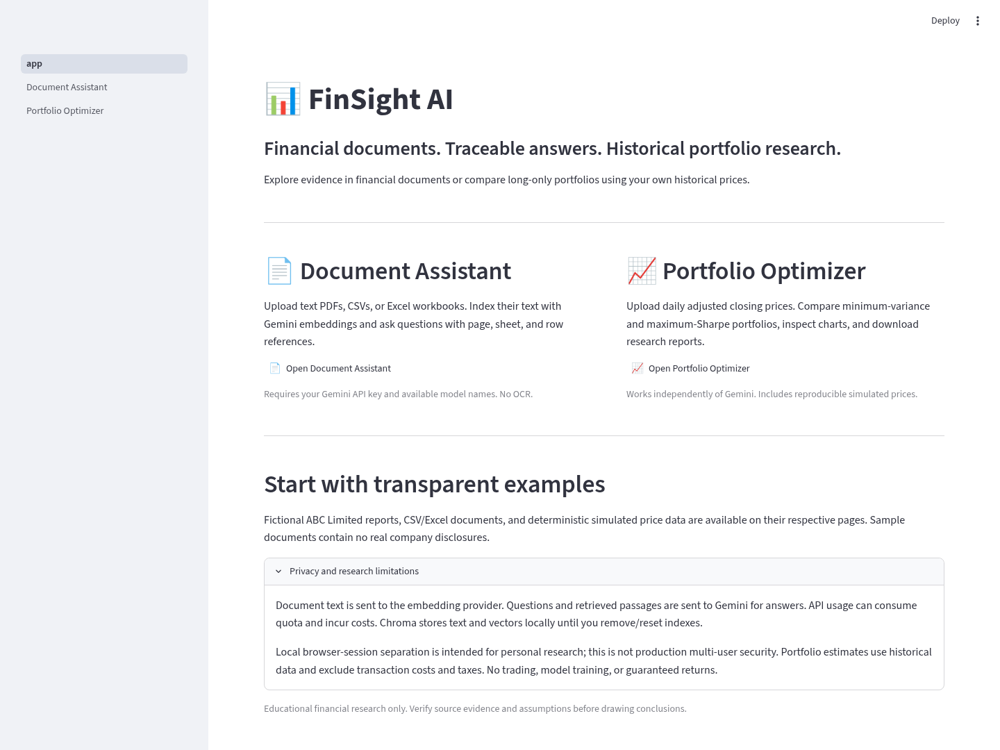

# FinSight AI — RAG-Powered Financial Document Assistant

A Python 3.12 / Streamlit application for **two independent educational research workflows**:

1. Ask questions about financial documents with retrieved evidence and source references.
2. Analyze daily historical prices with long-only minimum-variance and maximum-Sharpe portfolios.

The application is a research tool, not a trading system. It does not train models, promise future returns, or claim production readiness.



## What is implemented

### Document Assistant

- PyPDF extraction from text-based PDFs, preserving 1-based page numbers. Password-protected/corrupt files are rejected. Image-only PDFs are explicitly unsupported; **no OCR** is included. Empty pages in mixed PDFs are skipped and disclosed in local inspection.
- Pandas CSV/Excel ingestion, preserving headers, Excel sheet names, and 1-based spreadsheet/CSV record references (header is row 1). Multi-line CSV fields use logical record numbers, not physical text-file line numbers.
- LangChain recursive text splitting (1,000 characters, 200 overlap) within each page/row, preserving source metadata and character offsets.
- Gemini `RETRIEVAL_DOCUMENT` and `RETRIEVAL_QUERY` embeddings using the same configurable model and 768 dimensions, with L2 normalization.
- Local Chroma cosine retrieval, explicit supplied embeddings (no implicit model download), content/configuration-addressed indexes, persistence, reuse, document removal, and session reset. Incompatible or incomplete indexes produce an actionable error.
- Gemini answers through the supported LangChain Google Gen AI integration, structured output, validated evidence IDs, expandable passages, and downloadable Markdown/JSON Q&A reports.
- Missing-information responses when no relevant evidence is retrieved or the model reports insufficient support; unsupported/invalid citations are rejected. Prompt injection instructions in documents are treated as untrusted content. These controls reduce risk; they do not prove every generated statement is correct.

### Portfolio Optimizer — no API key needed

- Strict CSV validation: `Date` plus at least two unique asset headers, at least 61 daily price observations, increasing unique ISO dates, and complete finite positive numeric prices. Invalid data is rejected; material invalid rows are not silently dropped.
- Daily simple returns, arithmetic mean historical returns × 252, and annualized sample covariance (ddof=1).
- CVXPY minimum variance and a convex maximum-Sharpe reformulation, with long-only/full-investment constraints, solver/convergence checks, and validated finite weights. No equal-weight fallback on failure.
- Allocation table, expected return/volatility/Sharpe metrics, historical risk–return comparison, prices rebased to 100, and downloadable PNG charts, CSV allocations, Markdown reports, and structured JSON reports.
- Reports include assets, date window, provenance, simulated-data flag, risk-free rate, solver status, covariance regularization, and assumptions. Results survive normal reruns/download clicks; changing a relevant input clears stale results.

## Setup — Python 3.12

Run commands from the repository root. No Docker, database server, GPU, downloaded local embedding model, or additional service is required. Exact resolved runtime and development dependencies are pinned in `requirements.txt` and `requirements-dev.txt`.

### Windows Command Prompt

```bat
git clone https://github.com/mamta-kumari28/FinSight-AI-RAG-Powered-Financial-Document-Assistant.git
cd FinSight-AI-RAG-Powered-Financial-Document-Assistant
py -3.12 -m venv .venv
.venv\Scripts\python.exe -m pip install -r requirements.txt
copy .env.example .env
.venv\Scripts\python.exe -m streamlit run app.py
```

Edit `.env` privately with your own key. Virtual-environment activation is optional. The direct `.exe` commands also work in PowerShell; **no execution-policy change is required**. Development tests:

```bat
.venv\Scripts\python.exe -m pip install -r requirements-dev.txt
.venv\Scripts\python.exe -m pip check
.venv\Scripts\python.exe -m pytest
```

### macOS / Linux

```sh
git clone https://github.com/mamta-kumari28/FinSight-AI-RAG-Powered-Financial-Document-Assistant.git
cd FinSight-AI-RAG-Powered-Financial-Document-Assistant
python3.12 -m venv .venv
.venv/bin/python -m pip install -r requirements.txt
cp .env.example .env
.venv/bin/python -m streamlit run app.py
```

Development and offline validation:

```sh
.venv/bin/python -m pip install -r requirements-dev.txt
.venv/bin/python -m pip check
.venv/bin/python -m pytest --cov=src --cov-report=term-missing
```

On a host with a read-only home directory, set `MPLCONFIGDIR` to a writable local directory before running charts. On normal desktop installations Matplotlib uses its standard cache automatically.

### Prepared cloud workspace

The prepared environment uses `/workspace/.venvs/finsight`. From this checkout:

```sh
/workspace/.venvs/finsight/bin/python -m streamlit run app.py --server.headless=true --server.address=127.0.0.1 --server.port=8501
/workspace/.venvs/finsight/bin/python -m pytest
```

Each cloud task is isolated. Use the existing checkout; a Git worktree is unnecessary unless explicitly requested. Live processes must be started again after restoring an environment snapshot.

## Secure Gemini configuration

The portfolio workflow works with a blank key. For document indexing and Q&A, configure these variables in your private `.env`, process environment, or Streamlit deployment secrets:

```dotenv
GEMINI_API_KEY=
GEMINI_CHAT_MODEL=gemini-flash-latest
GEMINI_EMBEDDING_MODEL=gemini-embedding-001
```

The defaults above are examples in the **official Google Gen AI SDK documentation**, not a guarantee that your key has access. No key is included. Never paste keys into screenshots, code, Git history, or public reports. In Streamlit Community Cloud use the application's Secrets settings; on other hosts use their secret manager/environment variables. `.env` and `.streamlit/secrets.toml` are ignored. Process environment takes precedence over `.env`/Streamlit secrets.

Open **Gemini Settings → Validate models / list available models** to inspect the actual Developer API `v1beta` metadata for your key. The app checks `generateContent` and `embedContent` support before indexing/asking. You can change the model names in the sidebar without editing code. To check environment-configured names from a terminal:

```sh
.venv/bin/python -m scripts.check_models
```

A listed model still needs a successful real request to prove current permission, quota, dimensional support, and availability. If a model returns 404, inspect the current catalog and choose an available model rather than guessing. The historic availability of `gemini-2.5-flash` or `gemini-3.8-flash` for another session is not used as proof here. An embedding model change creates a separate index identity; old indexes must be removed/rebuilt before retrieval with the new configuration.

Outbound destinations: `generativelanguage.googleapis.com` for model metadata, embeddings, and generation; package registries for installation. Network restrictions may require allowing that API destination. Authentication, quota, model, and network errors are displayed without reflecting provider payloads or credentials.

**Privacy and cost:** document text is sent to Gemini for embedding. Your question and the retrieved passages are sent for answer generation. These calls consume quota and may incur charges. Local inspection and all portfolio calculations do not call Gemini. Only share documents you are authorized to send to the provider.

## Samples and reproducible demonstration

All samples in `data/samples/` are fictional or simulated; they are downloadable on the relevant page.

| Input | Purpose |
| --- | --- |
| `abc_financial_report.pdf` | One-page ABC Limited report: revenue 2024 Rs. 100 crore; revenue 2025 Rs. 120 crore; net profit 2025 Rs. 15 crore |
| `abc_long_report.pdf` | Four-page financial/research report, producing multiple chunks with page citations |
| `financial_summary.csv` | Financial facts with header/row references |
| `financial_summary.xlsx` | Financials and Notes sheets with sheet/row references |
| `synthetic_prices.csv` | 253 business-day observations for three simulated assets; PCG64 seed 2025; no real market prices |

With a working Gemini configuration, expected **document-grounded** results are an increase of Rs. 20 crore, growth of 20%, and net profit of Rs. 15 crore. Revenue in 2030 is unavailable. These figures are in the sample documents; the app does **not** hard-code their answers. Real generation can vary; verify the evidence and arithmetic.

Regenerate public samples with `.venv/bin/python scripts/generate_samples.py` after installing development dependencies. The generator performs no API requests. On Windows use `.venv\Scripts\python.exe` instead.

For portfolio CSVs, use `Date,AssetA,AssetB,...`, ISO daily dates, and adjusted closing prices. The app cannot verify whether a provider actually adjusted prices or whether declared provenance is true. Use aligned trading-day observations; missing-market-day calendars and adjustment quality remain the researcher's responsibility. For the bundled simulated prices at 4% annual risk-free rate, both strategies should solve; reports explicitly identify the data as simulated.

## Architecture and storage

```text
Document uploads → validated PDF/table loaders → LangChain chunks + source metadata
                → Gemini document embeddings → session-local Chroma persistence
Question → Gemini query embedding → top-k cosine retrieval → Gemini structured answer
         → source validation + expandable evidence → Q&A Markdown/JSON

Price CSV → strict validation → daily returns → annualized estimates + covariance ridge
          → CVXPY minimum variance / convex maximum Sharpe → validated allocations
          → metrics + Matplotlib charts → CSV / Markdown / JSON / PNG downloads
```

The running pages import the modules in `src/`; there are no alternate unused implementations. See [Architecture](docs/ARCHITECTURE.md) for module responsibilities and the actual optimization mathematics.

Chroma stores document text, metadata, and vectors under ignored `data/chroma/<random-session-id>/`. Raw uploaded files are held in Streamlit memory, not saved as uploads. Browser sessions receive separate random namespaces; this is **local research isolation, not production multi-user security or authentication**. Normal reruns reuse the session. A browser/server session restart can create a new namespace; old local files can remain on disk. Use removal/reset for the active session; to erase all retained local indexes, stop the app and remove `data/chroma/` yourself. Logical deletion is not guaranteed forensic erasure. Reports are generated in memory and sent as downloads; the application does not save private reports automatically. Browser downloads and backups are your responsibility.

## Portfolio assumptions

For daily simple returns `r[t] = P[t]/P[t-1] - 1`:

- `mu = mean(r) * 252`; `Sigma_sample = sample_cov(r) * 252`.
- Ridge `epsilon = max(trace(Sigma_sample)/n, 1e-6) * 1e-8`; both optimization and reported portfolio risk use `Sigma = symmetrize(Sigma_sample) + epsilon I`. The raw/adjusted covariance and ridge are in JSON reports.
- Minimum variance minimizes `wᵀ Sigma w`, subject to `w >= 0`, `sum(w) = 1`.
- Maximum Sharpe sets `a = mu - rf`, minimizes `yᵀ Sigma y` subject to `aᵀ y = 1`, `y >= 0`, then recovers `w = y / sum(y)`. This solves the positive-excess-return case; at least one `a[i] > 0` is required. It is not a non-DCP ratio objective.
- Annual risk-free rate uses the same annual arithmetic-return units as `mu`. Volatility is `sqrt(wᵀ Sigma w)` and Sharpe is `(muᵀw - rf)/volatility`.
- Solvers are chosen from installed CLARABEL, OSQP, SCS, in that order. Only an optimal status with validated residuals/weights is accepted. Tiny negative roundoff is clipped; solver failures are never replaced with an arbitrary allocation. An unavailable maximum-Sharpe result is reported while a successful minimum-variance result remains usable.

No transaction costs, taxes, liquidity constraints, or rebalancing simulation. This is an **in-sample historical illustration, not a backtest**. Arithmetic annualization is not CAGR. Estimated means/covariances and weights can be highly unstable; no future-return guarantees.

## Verification status

The current implementation has its own tests and evidence, independent of any earlier workspace or test claims. See [Validation report](docs/VALIDATION_REPORT.md) for the actual final results, browser checks, screenshots, and unresolved external prerequisites.

Offline tests exercise real PyPDF/Pandas ingestion, real Chroma persistence/retrieval with an explicitly labeled deterministic **test embedder**, real CVXPY solvers, reports, and Streamlit state. Provider mocks only verify API boundaries/error behavior; they are not live Gemini validation. No test downloads an embedding model.

Live checks are opt-in and consume quota:

```sh
.venv/bin/python -m pytest -m live --live -v tests/test_live_gemini.py
```

Browser checks (optional): install development dependencies, then `python -m playwright install chromium` or set `CHROMIUM_EXECUTABLE` to an installed Chromium. On Linux you may also need the browser's OS libraries (`python -m playwright install --with-deps chromium` where supported). Run `.venv/bin/python scripts/browser_smoke.py` from the repository root. It starts its own server, exercises actual upload/download paths, captures screenshots, and stops only its own server. Browser validation is optional in CI; the offline pytest suite is required. Windows and macOS instructions are provided but are not claimed as tested on those operating systems.

Actual screenshots: [Home](docs/screenshots/home.png), [local document inspection](docs/screenshots/document_inspection.png), [portfolio results](docs/screenshots/portfolio_results.png). No live indexing/Q&A screenshot is presented without a successful real provider request.

## Guides

- [Architecture and mathematics](docs/ARCHITECTURE.md)
- [Interview guide](docs/INTERVIEW_GUIDE.md)
- [Demo guide](docs/DEMO_GUIDE.md)
- [Validation evidence and limitations](docs/VALIDATION_REPORT.md)

GitHub Actions runs the offline suite on Python 3.12. There is no OCR, live market feed, model fine-tuning/training, automated trading, or production identity/access-control layer.
